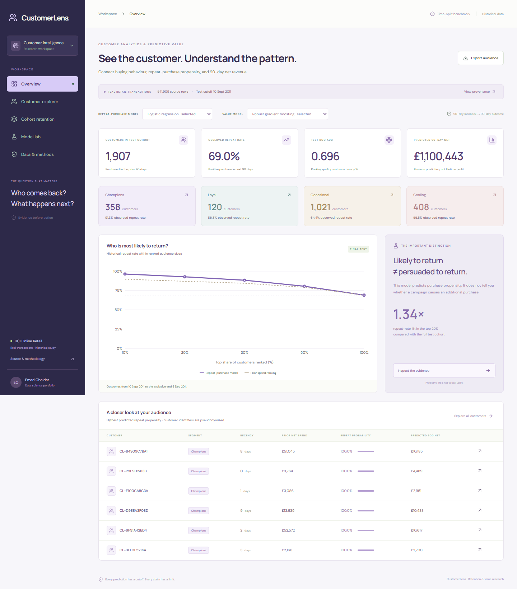

# CustomerLens

A reproducible customer analytics portfolio project: repeat-purchase propensity, revenue forecasting, RFM segments and cohort retention over real retail transactions.



## What works

- Explore 1,907 held-out customers, filter segments/countries, inspect individual predictions and export CSV.
- Compare prevalence, logistic regression and gradient boosting with calibration, AUC, Brier score and audience ranking curves.
- Inspect cohort retention and a transparent data-quality audit.
- Rebuild the Python pipeline from a fingerprinted public workbook; audit transactions in SQLite.

This is a historical research dashboard with precomputed predictions. Model selectors switch measured experiments; they do not launch training or contact customers.

## Results

Validation selected logistic regression. On the final temporal test, ROC AUC is **0.696**, Brier score **0.201**, and the top-ranked 20% have a **92.7%** repeat-purchase rate versus **69.0%** overall (1.34x predictive lift). These are predictive associations, not campaign uplift.

The validation-selected revenue model has test MAE **GBP 869.46**, worse than the trailing-spend baseline's **GBP 841.54**. That failure is preserved in the dashboard and decision memo.

## Run locally

Requires Python 3.12+ and Node.js 20+.

```powershell
python -m venv .venv
.\.venv\Scripts\Activate.ps1
pip install -r requirements.txt
python -m customerlens.fetch_data
$env:OMP_NUM_THREADS='2'
python -m customerlens.pipeline
npm ci
npm run dev
```

Open http://127.0.0.1:5181. The checked-in benchmark already supports running the UI without downloading or training.

```powershell
python -m pytest -q tests/test_science.py
npx playwright install chromium
npm test
npm run build
```

Eight statistical tests and three browser tests cover temporal boundaries, leakage invariants, credits, model selection, metric consistency and the interactive workflows. The included CI workflow runs these checks; no hosted CI run is claimed.

## Design and evidence

- [Methodology](docs/methodology.md)
- [Decision memo](docs/decision-memo.md)
- [Computed metrics](docs/metrics.json)
- [Python pipeline](customerlens/pipeline.py)

## Data and licence

Daqing Chen (2015), **Online Retail**, UCI Machine Learning Repository, DOI [10.24432/C5BW33](https://doi.org/10.24432/C5BW33), licensed [CC BY 4.0](https://creativecommons.org/licenses/by/4.0/). The source contains 541,909 transaction rows from December 2010 to December 2011. Data are cleaned, aggregated and used to generate the included benchmark; those transformations are ours. The raw workbook is downloaded separately and excluded from Git. Its SHA-256 and provenance are recorded in `data/source.json`.

Code is MIT licensed. The dataset and derived data retain their separate attribution obligations. Customer labels are pseudonymous hashes, not a guarantee of anonymity.
